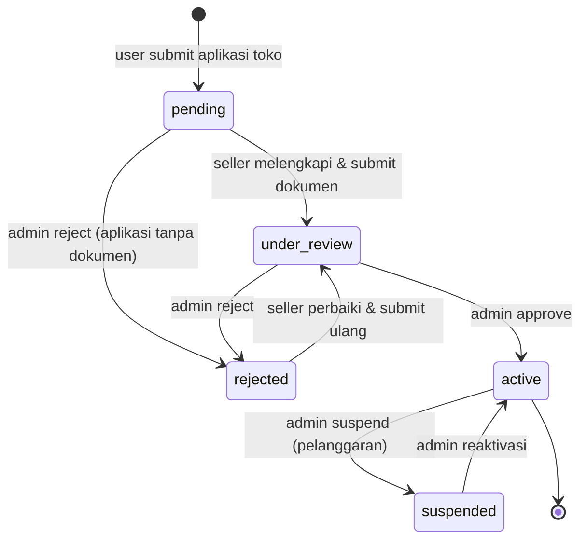
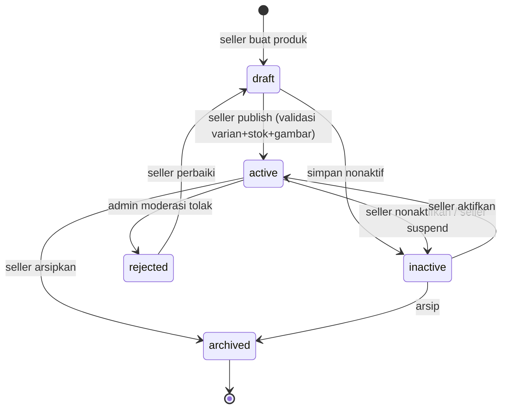
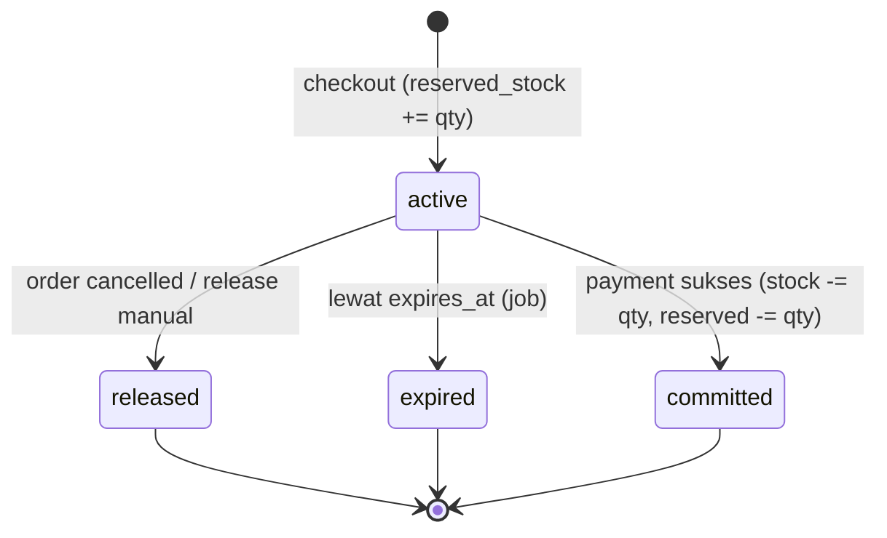
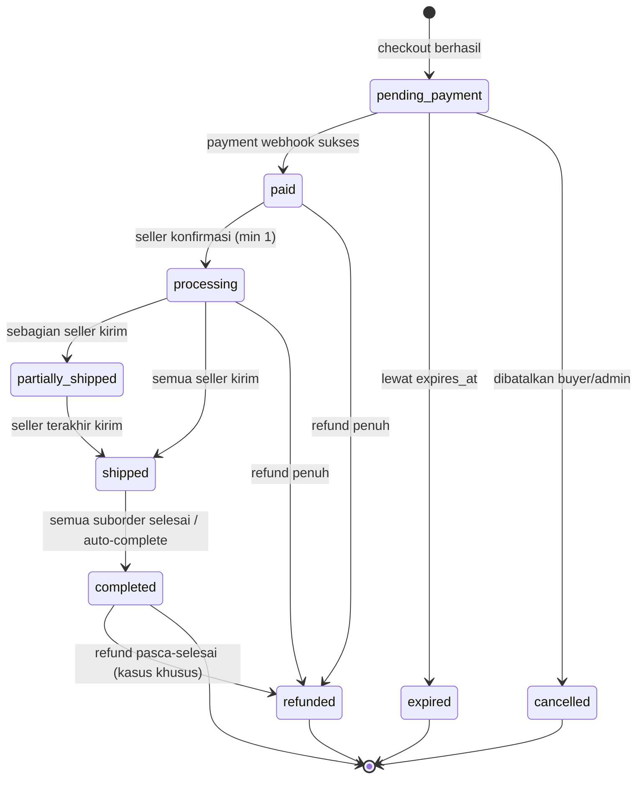
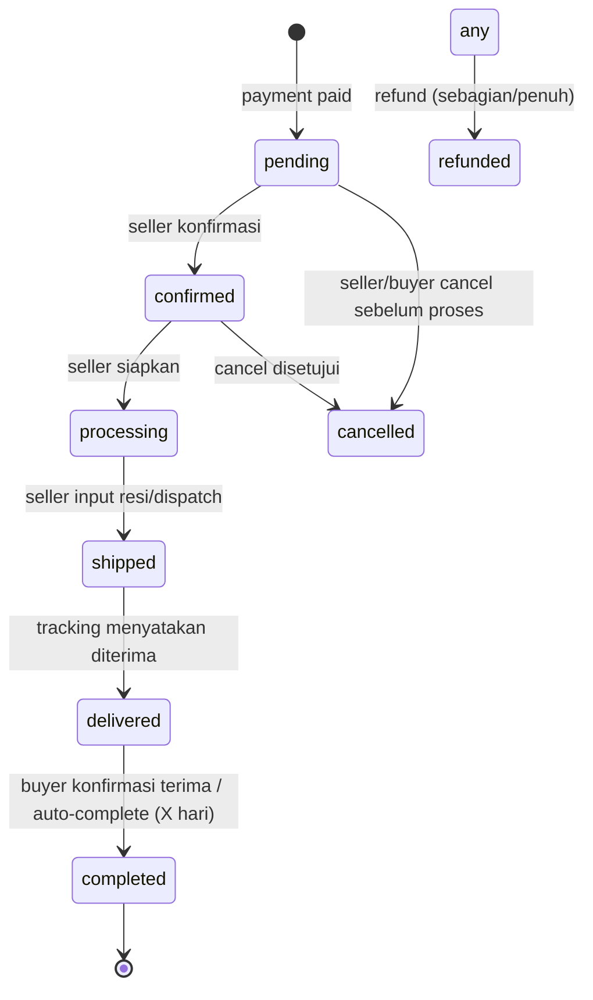
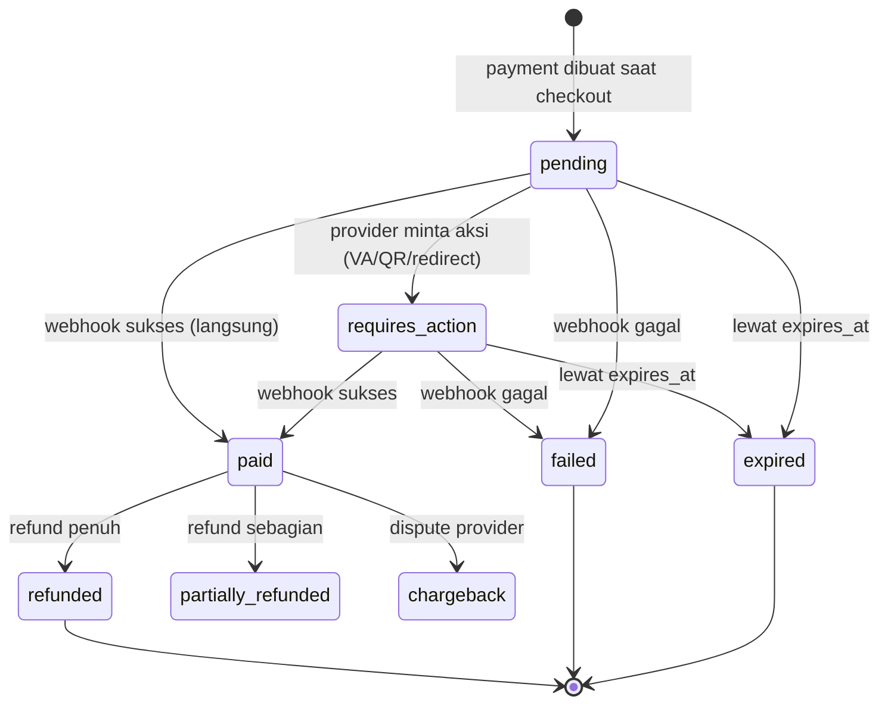
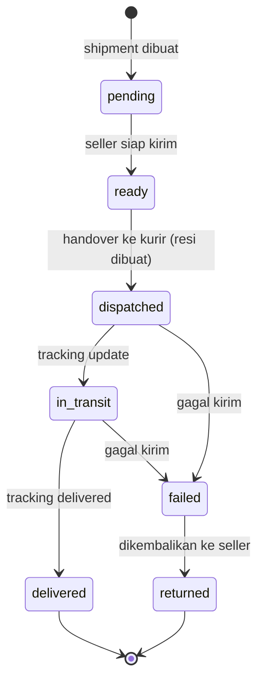
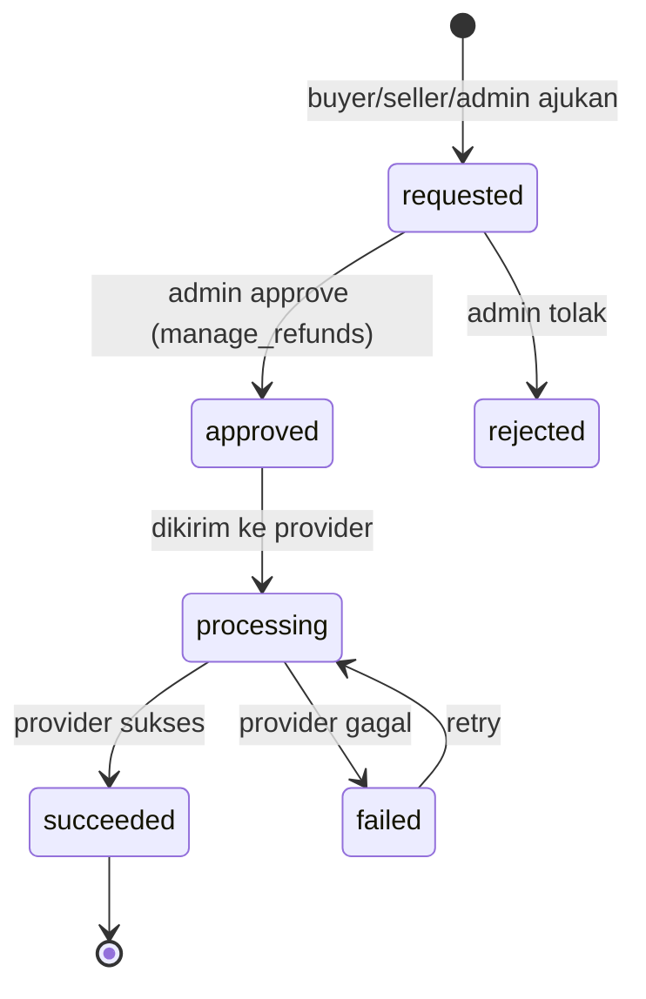
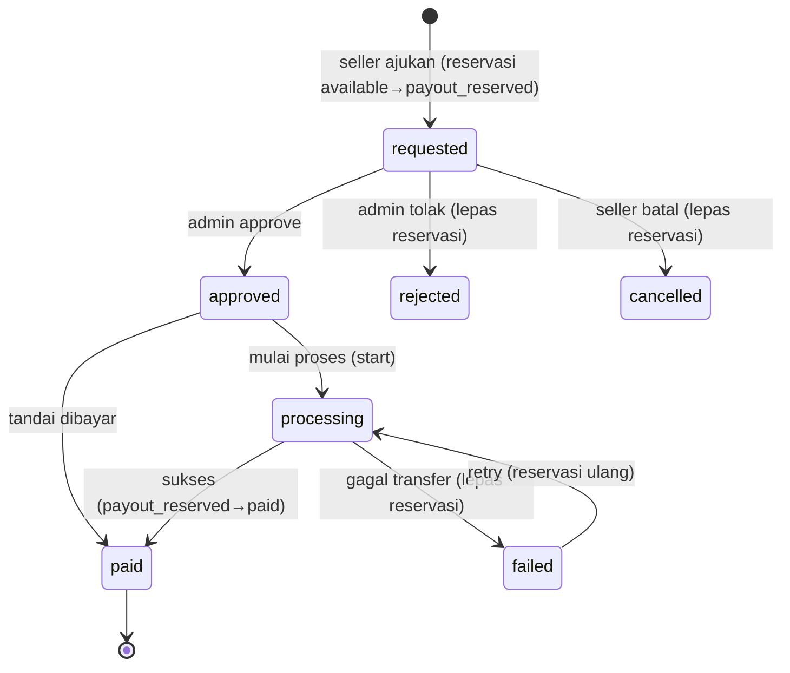

# 05 — Lifecycle & State Transitions

Dokumen ini mendefinisikan status resmi dan transisi yang sah untuk: **Seller, Product, Order, SellerOrder, Payment, Shipment, Payout, Inventory Reservation, Refund, Settlement.**

Transisi yang tidak terdaftar di sini **harus ditolak** (guard di Action + test).

---

## 1. Seller Lifecycle

**Status:** `pending` → `under_review` → `active` | `rejected`; `active` → `suspended` → `active`



| From | To | Trigger | Aktor | Guard |
|---|---|---|---|---|
| — | pending | Buat aplikasi seller | Customer | user belum punya seller |
| pending | under_review | Submit dokumen lengkap | Seller | dokumen wajib ada |
| pending | rejected | Reject sebelum dokumen | Admin (`approve_sellers`) | alasan wajib |
| under_review | active | Approve | Admin (`approve_sellers`) | status = under_review **dan** dokumen KYC wajib lengkap |
| under_review | rejected | Reject | Admin | alasan wajib |
| rejected | under_review | Resubmit | Seller | ada perbaikan |
| active | suspended | Suspend | Admin (`suspend_sellers`) | status = active |
| suspended | active | Reactivate | Admin | status = suspended |

**Aturan turunan:** seller hanya bisa membuat/mengaktifkan produk & menerima order saat `status = active`. Seller `suspended` → produk otomatis `inactive` (job), order berjalan tetap diselesaikan.

---

## 2. Product Lifecycle

**Status:** `draft` → `active` | `inactive`; `active` ↔ `inactive`; → `archived`; admin bisa `rejected`.



| From | To | Trigger | Guard |
|---|---|---|---|
| — | draft | create product | seller aktif (produk **selalu** lahir `draft`) |
| draft | active | publish | min 1 varian aktif, ada harga, ada ≥1 gambar |
| active ↔ inactive | toggle | seller | — |
| active | rejected | moderasi admin | ada alasan |
| any | archived | archive | produk tidak boleh dihapus jika pernah di-order |

**Aturan:** produk hanya tampil di marketplace bila `status = active` **dan** seller `active` **dan** minimal satu varian `active` dengan stok tersedia.

**Implementasi (Phase 3):** seller dapat menetapkan `draft`/`active`/`inactive`/`archived` (tidak boleh `rejected`); admin dapat menetapkan `active`/`inactive`/`rejected`. Transisi ke `active` divalidasi oleh `EnsureProductPublishableAction` (≥1 varian aktif + ≥1 gambar) → bila gagal: `422 PRODUCT_NOT_PUBLISHABLE`.

---

## 3a. Cart & Reservation Implementation (Phase 4)

- Cart menyimpan `variant_id` + `quantity` saja; **harga tidak disimpan**.
- Reservasi dibuat saat checkout: `inventory_reservations.status = active`, `expires_at = now + 24 jam`.
- `reserved_stock` dinaikkan di dalam transaksi dengan `SELECT ... FOR UPDATE` pada baris `inventories` (diurutkan by `variant_id` untuk mengurangi deadlock).
- Satu checkout = satu parent order + satu sub-order per seller; status awal `pending_payment` / `pending`.
- `order_status_histories` dan `seller_order_status_histories` mencatat transisi (`null → pending_payment`).
- Idempotency disimpan di `idempotency_keys` dengan hash payload; key baru disimpan **di dalam** transaksi bisnis.
- Job terjadwal: `ExpireOrdersJob` (order kedaluwarsa → `expired`) dan `ReleaseExpiredReservationsJob` (jaring pengaman) setiap menit.

---

## 3. Inventory Reservation Lifecycle

**Status:** `active` → `committed` | `released` | `expired`



| From | To | Trigger | Efek stok |
|---|---|---|---|
| — | active | Checkout | `reserved_stock += qty` |
| active | committed | Payment paid | `stock -= qty`, `reserved_stock -= qty` |
| active | released | Cancel / gagal bayar | `reserved_stock -= qty` |
| active | expired | Job `ReleaseExpiredReservations` | `reserved_stock -= qty` |

**Idempotensi:** transisi hanya boleh sekali; cek `status = 'active'` di dalam lock. `inventory_movements` mencatat setiap perubahan.

**Implementasi (Phase 5):** transisi `active → committed` dilakukan `CommitReservationAction` saat webhook pembayaran menyatakan `paid`. Baris `inventories` dikunci (`FOR UPDATE`, urut `variant_id`) lalu `stock -= qty` dan `reserved_stock -= qty`; reservasi non-`active` diabaikan sehingga webhook ganda tidak pernah mengurangi stok dua kali.

---

## 4. Order Lifecycle (Parent Order)

**Status:** `pending_payment` → `paid` → `processing` → `partially_shipped` → `shipped` → `completed`; plus `cancelled`, `expired`, `refunded`.



**Aturan status parent (diturunkan dari suborder):**

| Kondisi suborder | Status parent |
|---|---|
| semua `pending` | `paid` |
| min 1 `confirmed`/`processing`, tidak ada yang `shipped` | `processing` |
| sebagian `shipped`/`delivered`, sebagian belum | `partially_shipped` |
| semua `shipped`/`delivered` | `shipped` |
| semua `completed` | `completed` |
| semua `cancelled` | `cancelled` |
| semua `refunded` | `refunded` |

Parent status **tidak** diubah manual; selalu dihitung ulang (`OrderStatusAggregator`) setelah perubahan suborder.

**Implementasi (Phase 6):** `OrderStatusAggregator::recompute()` dipanggil setiap kali sub-order berubah (confirm/dispatch/delivered/confirm-received/auto-complete). Aturan: semua `pending` → `paid`; ada `confirmed/processing` tanpa yang dikirim → `processing`; sebagian dikirim → `partially_shipped`; semua dikirim/diterima → `shipped`; semua `completed` → `completed`. Hanya status pengiriman (`paid`,`processing`,`partially_shipped`,`shipped`,`completed`) yang diagregasi; `pending_payment`/`expired`/`cancelled`/`refunded` tidak disentuh. Setiap perubahan menulis `order_status_histories`.

---

## 5. SellerOrder Lifecycle

**Status:** `pending` → `confirmed` → `processing` → `shipped` → `delivered` → `completed`; plus `cancelled`, `refunded`.



| From | To | Trigger | Aktor | Guard |
|---|---|---|---|---|
| pending | confirmed | confirm | Seller | order paid, reservation committed |
| confirmed | processing | process | Seller | — |
| processing | shipped | create shipment / dispatch | Seller | ada shipment + resi |
| shipped | delivered | tracking delivered | System/Provider | — |
| delivered | completed | confirm received / auto | Buyer/System | delivered + X hari (auto) |
| pending/confirmed | cancelled | cancel | Seller/Buyer/System | belum shipped; butuh alasan |
| any | refunded | refund | Admin/System | sesuai kebijakan |

**Efek samping saat `completed` (atau `delivered` + hold):** trigger settlement evaluation untuk suborder tersebut.

---

## 6. Payment Lifecycle

**Status:** `pending` → `requires_action` → `paid` | `failed` | `expired`; `paid` → `refunded` | `partially_refunded` | `chargeback`.



| From | To | Trigger | Guard kritis |
|---|---|---|---|
| — | pending | Checkout | amount = order.grand_total |
| pending/requires_action | paid | Webhook | signature valid, amount cocok, **belum paid** (lock) |
| pending/requires_action | failed | Webhook | signature valid |
| pending/requires_action | expired | Job expiry | belum paid |
| paid | refunded | Refund penuh sukses | total refund = amount |
| paid | partially_refunded | Refund sebagian sukses | total refund < amount |
| paid | chargeback | Webhook dispute | — |

**Aturan idempotensi:** setiap webhook disimpan ke `payment_webhook_events` (unique `provider_event_id`) sebelum diproses. Event yang sudah `processed` langsung di-ack. Transisi status payment dilakukan di dalam DB transaction dengan `SELECT ... FOR UPDATE` pada baris payment. **Tidak ada** dua transisi `→ paid`.

**Retry:** `POST /orders/{orderNumber}/payment/retry` hanya boleh dari status `pending`/`requires_action`/`expired`/`failed` yang belum `paid`, dan membuat `payment_attempts` baru.

**Implementasi (Phase 5):** payment dibuat setelah checkout commit (`pending → requires_action` saat provider mengembalikan token). Webhook memakai `payment_webhook_events` (unique `provider_event_id`) sebagai kunci idempotensi; transisi `→ paid` dilakukan di dalam transaksi dengan `SELECT ... FOR UPDATE` pada baris `payments` dan menjadi **no-op** bila status sudah `paid`. Efek samping `→ paid`: order menjadi `paid`, seluruh reservasi `active` order menjadi `committed` (lihat §3). Gateway aktif dipilih lewat `zentro.payment.driver` (`fake`/`midtrans`); `MidtransGateway` memakai Core API (QRIS, e-wallet, VA semua bank) dan sudah aktif di sandbox sejak 2026-11-11 — lihat [docs/22](22-midtrans-integration.md).

---

## 7. Shipment Lifecycle

**Status:** `pending` → `ready` → `dispatched` → `in_transit` → `delivered`; plus `failed`, `returned`.



| From | To | Trigger | Efek |
|---|---|---|---|
| — | pending | `POST /seller/orders/{id}/shipments` | seller_order → belum berubah |
| pending | ready | seller siapkan | — |
| ready | dispatched | dispatch + tracking number | seller_order → `shipped` |
| dispatched/in_transit | delivered | tracking webhook | seller_order → `delivered` |
| any active | failed | tracking gagal | notifikasi buyer/seller |
| failed | returned | dikembalikan | kandidat refund |

**Implementasi (Phase 6):** `shipments` dibuat otomatis (`pending`) saat pembayaran sukses, satu per `seller_order` (tanpa UNIQUE untuk kesiapan partial shipment). Transisi divalidasi `ShipmentStatus::canTransitionTo()`; dispatch menggerakkan `seller_order` `confirmed → processing → shipped`, lalu webhook `delivered` mengubahnya ke `delivered`. Webhook memakai `shipping_webhook_events` (unique `provider_event_id`) dan `shipment_histories.provider_event_id` untuk idempotensi. Job `SyncShipmentTrackingJob` menjadi jaring pengaman bila webhook hilang; `AutoCompleteShipmentsJob` menyelesaikan `delivered` setelah `auto_complete_days` (default 7 hari). Efek finansial (`failed`/`returned` → refund) ditangani Phase 7.

---

## 8. Refund Lifecycle

**Status:** `requested` → `approved` → `processing` → `succeeded`; plus `failed`, `rejected`.



**Efek finansial saat `succeeded`:**
- Alokasi berbasis komponen (`RefundAllocation`): refund dipecah `product_amount` / `shipping_amount`.
  - Debit seller = `seller_product_net × (refund_produk / (basis_komisi − voucher_platform))` + `refund_ongkir`
    (memakai **delta kumulatif** agar pembulatan tidak menumpuk).
  - Pembalik komisi = `komisi × (refund_produk / (basis_komisi − voucher_platform))`.
- Tulis `wallet_transactions` tipe `refund_debit` (debit `pending` jika komisi belum earned, `available` jika sudah).
- Jika dana sudah `paid` (sudah payout), catat saldo negatif → utang dikompensasi payout berikutnya (lihat Assumptions B-9).
- `commissions.status = reversed` hanya bila **produk habis** direfund; parsial hanya menambah `commission_reversed_amount`.
- Update `payments.status` menjadi `refunded`/`partially_refunded`; sub-order jadi `refunded` hanya bila produk **dan** ongkir habis.

**Idempotensi gateway (Fase 8A):** `provider_refund_key` dibuat & disimpan **sebelum** memanggil provider, lalu dipakai ulang pada retry. Bila gateway sudah sukses (`provider_reference` terisi) tetapi `finalize` gagal, refund tetap `processing`; retry berikutnya hanya mengulang finalize **tanpa** memanggil gateway lagi (mencegah refund ganda).

---

## 9. Settlement & Wallet Lifecycle

### 9.1 Komisi

`pending` → `earned` → `reversed`

| From | To | Trigger |
|---|---|---|
| — | pending | Payment paid (snapshot rate & base) |
| pending | earned | Suborder `completed` + masa hold (settlement) terpenuhi |
| any | reversed | Refund/dispute yang membatalkan komisi |

### 9.2 Dana Seller (bucket)

```
Payment paid
   → wallet_transactions: sale_pending (+amount → bucket pending)
Suborder completed + hold terpenuhi (settlement)
   → wallet_transactions: settlement_release (-pending, +available)
Seller ajukan payout
   → wallet_transactions: payout_hold (-available, +payout_reserved)
   → seller_payouts: requested
Payout dipindah ke processing → gagal (opsional)
   → wallet_transactions: payout_release (-payout_reserved, +available)   [fail/reject/cancel]
   → retry: payout_hold (-available, +payout_reserved)
Payout dikonfirmasi sukses (admin/sistem)
   → wallet_transactions: payout (-payout_reserved, +paid)
   → seller_payouts: paid
```

**Bucket:** `pending` (belum settlement), `available` (siap dicairkan), `payout_reserved` (dikunci untuk payout berjalan), `risk_hold` (reserve risiko), `debt` (utang seller), `paid` (sudah dibayar). Dana payout **direservasi sejak pengajuan**; `available` **tidak** pernah negatif — kekurangan refund menjadi `debt` eksplisit.

**Aturan:** dana seller **tidak** langsung dianggap cair saat pembayaran sukses; harus melewati settlement.

**Implementasi:** saat pembayaran sukses, `CreateCommissionAction` membuat `commissions` (snapshot `base_amount`/`rate_bp`, status `pending`) + mengisi kolom komisi `seller_orders` + mencatat ledger `sale_pending` ke bucket `pending` sebesar `seller_net_amount` (= `grand_total − commission`). `SettlementReleaseJob` memindahkan **sisa yang belum direfund** (`seller_net − seller_refunded`) `pending → debt` lebih dulu (pelunasan utang) lalu `pending → available`, dan menandai komisi `earned` setelah sub-order `completed` melewati `settlement_hold_days`. Bila seller punya `seller_risk_profiles.reserve_rate_bp > 0`, sebagian `available → risk_hold` dan dilepas oleh `ReleaseRiskHoldJob` setelah `hold_days`. Refund mendebit `pending`/`available` secara proporsional; bila `available` kurang, sisanya menjadi `debt`. Payout: `RequestPayoutAction` memindahkan `available → payout_reserved`; `ProcessPayoutAction::mark_paid` memindahkan `payout_reserved → paid` (ditolak bila seller masih punya utang). Ledger **immutable**; setiap baris menjaga `balance_after = balance_before + amount`.

### 9.3 Payout

**Status:** `requested` → `approved` → `processing` → `paid`; plus `rejected`, `failed`, `cancelled`.



| From | To | Trigger | Guard kritis |
|---|---|---|---|
| — | requested | Seller ajukan | amount ≤ available_balance; ada rekening bank; tidak ada payout aktif; **reservasi `available → payout_reserved`** |
| requested | approved | Admin approve | reservasi masih cukup |
| requested | rejected | Admin reject | alasan; **lepas reservasi `payout_reserved → available`** |
| requested | cancelled | Seller cancel | belum approved; **lepas reservasi** |
| approved | processing | Admin start | lock wallet; reservasi masih cukup |
| approved | paid | Admin mark_paid | transfer sukses; `payout_reserved → paid` |
| processing | paid | Transfer sukses | ledger `payout` debit `payout_reserved`, kredit `paid` |
| processing | failed | Transfer gagal | **lepas reservasi `payout_reserved → available`** (tanpa hapus ledger) |
| failed | processing | Retry | **reservasi ulang `available → payout_reserved`** |

**Idempotensi:** `POST /seller/payouts` menerima `Idempotency-Key`; `POST /admin/payouts/{id}/process` mengunci baris payout (`FOR UPDATE`). `mark_paid` idempoten (status `paid` → no-op). Proses ganda tidak menggandakan ledger.

---

## 10. Voucher Lifecycle

| Kondisi | Aturan |
|---|---|
| `starts_at > now` | belum aktif (reject) |
| `expires_at < now` | tidak berlaku (reject) |
| `is_active = false` | tidak berlaku |
| `used_count >= usage_limit` | habis (reject) |
| per-user usage tercapai | reject untuk user tsb |
| `min_purchase` tidak terpenuhi | reject |
| scope `seller` | hanya berlaku untuk produk seller tsb |

Kalkulasi diskon percent: `min(subtotal_applicable * value_bp / 10000, max_discount)`.

---

## 11. Order Expiry & Auto-complete Rules (parameter)

| Parameter | Nilai default | Sumber |
|---|---|---|
| Batas bayar order | 24 jam | `platform_settings.order.payment_timeout_hours` |
| Reservation expiry | = batas bayar | — |
| Auto-complete setelah delivered | 7 hari | `platform_settings.order.auto_complete_days` |
| Settlement hold setelah completed | 7 hari | `platform_settings.finance.settlement_hold_days` |
| Batas retensi webhook | 12 bulan | `platform_settings.retention.webhook_months` |

Semua parameter disimpan di `platform_settings` agar dapat diubah tanpa deploy.

---

## 12. Tabel Transisi Terlarang (contoh guard yang wajib ditest)

| Skenario terlarang | Alasan |
|---|---|
| `pending_payment` → `completed` | Lompat tanpa bayar |
| `paid` → `paid` (webhook kedua) | Double-pay |
| `cancelled` → `processing` | Order batal tidak boleh diproses |
| `expired` → `paid` | Reservation sudah dilepas |
| payment `refunded` → `paid` | — |
| payout `paid` → `approved` | Ledger sudah final |
| `committed` → `released` | Stok sudah dikurangi |
| `released` → `committed` | Reservation sudah dilepas |
| `reversed` → `earned` tanpa pembalik | Melanggar immutability |
